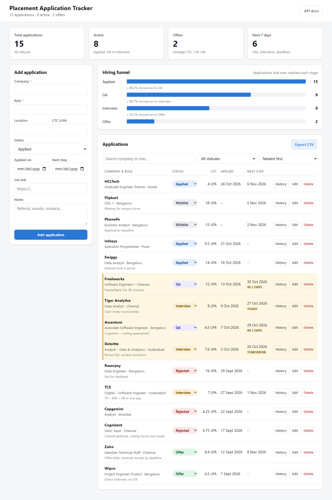
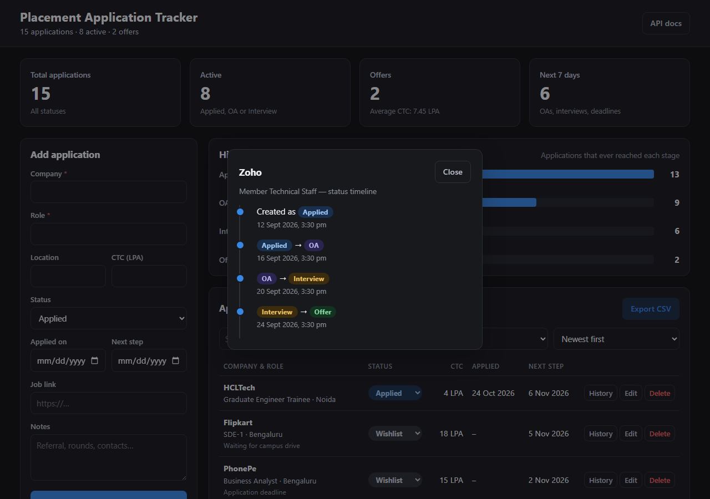

# Placement Application Tracker


A full-stack web app to track job and placement applications through the hiring funnel:
**Wishlist → Applied → OA → Interview → Offer / Rejected**.

I built this to track my own placement season. With 15+ companies running in parallel, each with its own
online assessment, interview dates and deadlines, a spreadsheet stopped being enough: I kept missing
dates and could not see where I was dropping out of the funnel. This app keeps every application in
one place, highlights what is due in the next few days, records every status change, and shows my
conversion rate at each stage, so I know whether to work on aptitude (OA), interviews or simply apply more.



## Features

- **Applications CRUD**: company, role, location, CTC (LPA), status, applied date, next-step date, job link, notes
- **Filter, search and sort**: filter by status, case-insensitive search on company or role, sort by next step / applied date / company / newest
- **Inline status changes** from the table; every change is saved in a `status_history` table
- **Status timeline** for each application, shown in a dialog
- **Dashboard**: total, active, offers (with average offer CTC), next steps in the next 7 days
- **Hiring funnel chart** drawn with plain CSS `<div>`s, with stage-to-stage conversion %
- **Due-soon highlighting**: rows with a next step in 3 days or less are highlighted with a *Today / Tomorrow / In N days* tag
- **CSV export** of all applications (streamed)
- **Validation on both sides**: friendly messages in the form, and the API rejects bad input with `422`
- **Light and dark mode** (follows the OS), responsive down to phone width
- **45 automated tests**, Docker setup, and a GitHub Actions CI pipeline



## Architecture

```
 ┌──────────────────────────┐   fetch() + JSON    ┌───────────────────────────────┐
 │ Browser                  │ ──────────────────► │ FastAPI  (app/main.py)        │
 │ static/index.html        │ ◄────────────────── │  routers/applications.py      │
 │ static/app.js (vanilla)  │    HTTP responses   │  routers/stats.py             │
 │ static/style.css         │                     │  Pydantic schemas validate I/O│
 └──────────────────────────┘                     └───────────────┬───────────────┘
                                                                  │ Python function calls
                                                  ┌───────────────▼───────────────┐
                                                  │ crud.py  (all DB queries)     │
                                                  │ SQLAlchemy 2.x ORM models     │
                                                  └───────────────┬───────────────┘
                                                                  │ SQL with bound parameters
                                                  ┌───────────────▼───────────────┐
                                                  │ SQLite  (tracker.db)          │
                                                  │ applications ─┐               │
                                                  │ status_history┘ 1-to-many     │
                                                  └───────────────────────────────┘
```

The same FastAPI process serves the API (`/api/...`) and the frontend files (`/` and `/static/...`),
so there is a single thing to run and no CORS setup.

## Data model

```
applications                                status_history
─────────────────────────────               ─────────────────────────────────
id              INTEGER  PK      1 ───── *  id              INTEGER PK
company         VARCHAR  required           application_id  INTEGER FK → applications.id
role            VARCHAR  required                           (ON DELETE CASCADE)
location        VARCHAR                     from_status     VARCHAR (NULL = just created)
ctc_lpa         FLOAT    ≥ 0                to_status       VARCHAR
status          VARCHAR  one of 6 values    changed_at      DATETIME (UTC)
applied_on      DATE
next_step_date  DATE     ≥ applied_on
job_link        VARCHAR  http(s) URL
notes           TEXT
created_at      DATETIME (UTC)
updated_at      DATETIME (UTC)
```

Status values: `Wishlist`, `Applied`, `OA`, `Interview`, `Offer`, `Rejected`.
A history row is written when an application is **created** (`NULL → status`) and on **every status change**.

## API

All endpoints return JSON except the CSV export. Interactive docs: **http://127.0.0.1:8000/docs** (Swagger UI, generated by FastAPI).

| Method | Path | What it does | Success | Errors |
|---|---|---|---|---|
| `GET` | `/health` | Liveness check → `{"status": "ok"}` | 200 | |
| `POST` | `/api/applications` | Create an application | 201 | 422 |
| `GET` | `/api/applications` | List. Query: `status`, `q` (search company/role), `sort` = `newest` (default) \| `next_step_date` \| `applied_on` \| `company` | 200 | 422 |
| `GET` | `/api/applications/{id}` | Get one | 200 | 404 |
| `PUT` | `/api/applications/{id}` | Update. **Partial**: only the fields in the body change (see below) | 200 | 404, 422 |
| `DELETE` | `/api/applications/{id}` | Delete (its history is deleted too) | 204 | 404 |
| `PATCH` | `/api/applications/{id}/status` | Body `{"status": "OA"}`; changes status and writes a history row | 200 | 404, 422 |
| `GET` | `/api/applications/{id}/history` | Status timeline, oldest first | 200 | 404 |
| `GET` | `/api/stats` | Counts per status, funnel, upcoming (7 days), average offer CTC | 200 | |
| `GET` | `/api/upcoming?days=7` | Applications with a next step from today to today + N days, soonest first | 200 | 422 |
| `GET` | `/api/export.csv` | Download every application as CSV | 200 | |

**Update semantics.** I kept one update endpoint: `PUT` with partial-update (PATCH-style) behaviour.
Fields you leave out are not touched; send `null` to clear an optional field. The web form always sends
every field, so for the UI it behaves like a normal full `PUT`. Status changes made through `PUT` are
recorded in the history as well.

**Validation (422).** Missing or blank `company`/`role`, a status outside the six values, negative
`ctc_lpa`, a `job_link` that does not start with `http(s)://`, and `next_step_date` before `applied_on`
(message: `next_step_date cannot be before applied_on`).

**Funnel definition.** An application has *reached* a stage if it was ever at that stage or a later one
(pipeline order: Applied → OA → Interview → Offer). This is computed from `status_history`, which also holds
the current status. Example: `Applied → Interview → Offer` counts as having reached OA too (the OA was
skipped, not failed). `Applied → OA → Rejected` reached Applied and OA. Wishlist items never reached Applied.
Conversion % = reached(next stage) ÷ reached(this stage) × 100, rounded to 1 decimal (0 if nothing reached
the stage). **Active** = Applied + OA + Interview. **Upcoming** excludes rejected applications.

All stats are computed by the database (`COUNT`, `GROUP BY`, `SUM(CASE …)`, `MAX`, `AVG`). The exact SQL is in
[docs/LEARNING_GUIDE.md](docs/LEARNING_GUIDE.md#5-the-sql-behind-apistats).

## Run it locally

Requires Python 3.12.

```bash
python -m venv .venv
.venv\Scripts\activate            # Windows (PowerShell)
# source .venv/bin/activate      # macOS / Linux
pip install -r requirements.txt
python seed.py                    # optional: 15 sample applications (made-up data)
uvicorn app.main:app --reload
```

Open **http://127.0.0.1:8000**. The database file `tracker.db` is created automatically.

- `python seed.py --reset` deletes everything and reloads the sample data.
- `SQL_ECHO=1` prints every SQL statement (PowerShell: `$env:SQL_ECHO="1"; uvicorn app.main:app`).
- `DATABASE_URL` switches the database (default `sqlite:///./tracker.db`).

## Run with Docker

```bash
docker compose up --build
docker compose exec web python seed.py     # optional sample data
```

Open **http://localhost:8000**. The SQLite file lives in the named volume `tracker-data`, so data survives
container restarts.

## Tests

```bash
pytest -v
```

45 tests (37 test functions, some parametrized) cover CRUD, filters, search, sorting, validation errors, 404s,
status-history creation, cascade delete, the stats and funnel math on a known fixture, the upcoming window,
the CSV export and the health check. Every test runs against a fresh **in-memory** SQLite database, so tests
never touch `tracker.db`. GitHub Actions runs the same suite on every push and pull request
([.github/workflows/ci.yml](.github/workflows/ci.yml)) and checks that the Docker image builds.

## Project structure

```
placement-application-tracker/
├── app/
│   ├── main.py               # creates the FastAPI app, mounts routers and static files
│   ├── database.py           # engine, session, Base, get_db dependency
│   ├── models.py             # SQLAlchemy models: Application, StatusHistory, Status enum
│   ├── schemas.py            # Pydantic request/response schemas + validation rules
│   ├── crud.py               # every database query (CRUD + stats)
│   └── routers/
│       ├── applications.py   # /api/applications..., /api/upcoming, /api/export.csv
│       └── stats.py          # /api/stats
├── static/                   # index.html, style.css, app.js (vanilla JS frontend)
├── tests/                    # pytest suite (conftest.py = isolated test database)
├── docs/                     # LEARNING_GUIDE.md, screenshots
├── seed.py                   # sample data
├── Dockerfile, docker-compose.yml
├── .github/workflows/ci.yml
└── requirements.txt
```

## Design decisions

- **Why FastAPI?** Type hints do triple duty: they parse and validate requests (via Pydantic), they document
  the API (the `/docs` page is generated), and they help the editor. It is also small enough to read end to end.
- **Why SQLite?** Zero setup: the database is one file and the driver is built into Python, which suits a
  single-user tool. All queries go through SQLAlchemy, so moving to PostgreSQL means changing `DATABASE_URL`, not code.
- **Why a `status_history` table instead of just a `status` column?** A single column only knows where an
  application is *now*. The history table remembers every step, which powers the timeline and makes the funnel
  honest: a rejected application still counts as having reached the OA stage. It is also a real one-to-many
  relationship with a foreign key and cascade delete.
- **Why vanilla JavaScript?** The UI is one page with a form, a table and a dialog. Plain `fetch`, DOM methods
  and `addEventListener` keep it free of build tools and dependencies, and show that I understand what
  frameworks like React do for you.
- **Why compute stats in SQL?** The database is built for counting and grouping; doing it in SQL sends a few
  numbers over the wire instead of every row, and it scales to large tables.

## What I'd add next

- **Authentication** (sign-up / login with hashed passwords and JWT tokens) and a `user_id` on each application, so several students can use one deployment
- **PostgreSQL** plus **Alembic** migrations instead of `create_all`
- **Deployment** on Render or Azure App Service, with the database as a managed service
- Email / calendar reminders the day before an OA or interview
- Pagination for the table once the list grows

---

Built with AI pair-programming assistance; every module is documented in [docs/LEARNING_GUIDE.md](docs/LEARNING_GUIDE.md).
